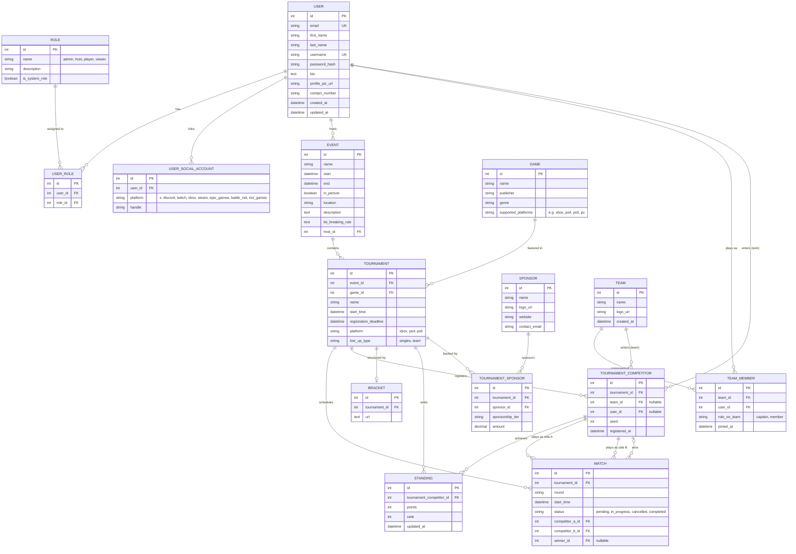

# Gaming Tournament Management System — Redesigned ERD

This redesign keeps your existing `Role` / `User` / `Event` structure but introduces a **Team** and **Game** entity, unifies tournament entries under a single `TOURNAMENT_COMPETITOR` concept (so it works for both singles and team play), and adds **Sponsor** as a many-to-many relationship. It also normalizes the six nullable social-handle columns on `User` into a flexible `USER_SOCIAL_ACCOUNT` table. `Event` now only tracks its host — attendee tracking has been removed.

## Key design decisions

- **`TEAM` + `TEAM_MEMBER`** — a team can have many players, and a player (user) can belong to more than one team over time, since `TEAM_MEMBER` is a join table rather than a `team_id` column on `User`.
- **`GAME` as its own entity** — `Tournament.game_id` points at it, so one game can back many tournaments without duplicating game metadata each time.
- **`TOURNAMENT_COMPETITOR` unifies singles and team entries** — it has both a nullable `team_id` and a nullable `user_id`. Which one is populated is driven by `Tournament.line_up_type`. This is the entity that both `Standing` and `Match` hang off of, so ranking and match logic doesn't need to branch on singles-vs-team.
- **`MATCH` references `TOURNAMENT_COMPETITOR` three times** — `competitor_a_id` and `competitor_b_id` are the two sides (mandatory), and `winner_id` is a nullable reference to whichever of the two won. Enforce at the app/DB level that `winner_id` must equal `competitor_a_id` or `competitor_b_id`.
- **`STANDING` keys off `tournament_competitor_id`** (not `tournament_id` + `team_id` directly) — since a competitor row is already scoped to one tournament, this naturally gives you "the same team/player has different standings across different tournaments" without duplicate foreign keys.
- **`SPONSOR` + `TOURNAMENT_SPONSOR`** — a standard many-to-many join, so a tournament can have several sponsors and a sponsor can back several tournaments, with tier/amount stored per sponsorship rather than per sponsor.
- **`USER_SOCIAL_ACCOUNT`** — replaces the six nullable `*_user` columns on `User` with rows, so adding a new platform later doesn't require a schema migration.

## Business rules to enforce outside the ERD

These aren't expressible as plain foreign keys and should live in application logic or DB constraints:
- `TOURNAMENT_COMPETITOR`: exactly one of `team_id` / `user_id` must be set, matching `Tournament.line_up_type`.
- `MATCH.winner_id`, when set, must equal `competitor_a_id` or `competitor_b_id`.
- `MATCH.competitor_a_id` and `competitor_b_id` should belong to the same `tournament_id` as the match itself.